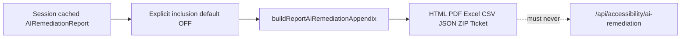

# AI-R4 Report & Export Integration — Final Gate Audit

Audit date: **2026-10-16**  
Scope: AI-R4 only (session-cached AI remediation → reports & exports). **No AI-R5.**

## Executive summary

| Gate | Result |
|------|--------|
| **AI-R4 GATE** | **PASS** |

AI-assisted remediation may be embedded in HTML, PDF, Excel, CSV, JSON, evidence ZIP, and developer tickets **only when the user explicitly opts in**. All export paths use cached session data and shared formatters; **zero** `fetchAiRemediation` / OpenAI calls on export.

## Verification runs

| Command | Result |
|---------|--------|
| `npm run test:ai-remediation` | PASS (78 tests) |
| `npm run test:security` | PASS (79 passed, 7 skipped) |
| `npm run test:sample-report` | PASS (5 tests) |
| `npx vitest run src/features/reports/__tests__` | PASS (7 tests) |
| `npm run lint` | PASS |
| `npm run typecheck` | PASS |
| `npm run build` | PASS |

## Architecture & data flow

## A. Single representation & collectors (spec A–E)

| Check | Evidence | Test | Status |
|-------|----------|------|--------|
| Normalized types | [`reportAiRemediation.ts`](src/features/reports/types/reportAiRemediation.ts) | Code review | PASS |
| Collectors → appendix → formatters | [`src/lib/ai/remediation/report/index.ts`](src/lib/ai/remediation/report/index.ts) | `aiR4Export.test.ts` | PASS |
| Exporters do not re-parse AI ad hoc | [`exportWebsiteWorkbook`](src/features/website-scanner/utils/export/exportWebsiteWorkbook.ts), [`exportAiRemediationCsv`](src/features/reports/utils/exportAiRemediationCsv.ts) | Code review | PASS |
| Report model appendix | [`reportModel.ts`](src/features/reports/types/reportModel.ts) `aiRemediationAppendix`, `REPORT_VERSION` **1.1** | `buildReport.test.ts` | PASS |

## B. No silent merge & default OFF (F–K)

| Check | Evidence | Test | Status |
|-------|----------|------|--------|
| No AI in main findings loop | [`buildWebsiteScanReport.ts`](src/features/website-scanner/utils/buildWebsiteScanReport.ts) — no `aiRemediationByGroup` in findings | Grep | PASS |
| Report settings default OFF | `includeAiRemediationAppendix: false` in [`reportSettings.ts`](src/features/reports/types/reportSettings.ts) | Code review | PASS |
| Website session default OFF | `includeAiRemediationInReport: false` in [`websiteScanReducer.ts`](src/features/website-scanner/state/websiteScanReducer.ts) | Code review | PASS |
| Export prefs default OFF | `includeAiRemediationInExports: false` in [`websiteDiscovery.ts`](src/features/website-scanner/types/websiteDiscovery.ts) | Code review | PASS |
| Strip appendix when flag off | [`applyReportSettings.ts`](src/features/reports/utils/applyReportSettings.ts) | `aiR4Export.test.ts` | PASS |

## C. Zero API on export (L–P)

| Check | Evidence | Test | Status |
|-------|----------|------|--------|
| No `fetchAiRemediation` in reports | Grep `src/features/reports` | Grep | PASS |
| No `fetchAiRemediation` in export utils | Grep `website-scanner/utils/export` | Grep | PASS |
| Export matrix zero-call | Mock throws on call | `aiR4GateAudit.test.ts` | PASS |
| Cost / data docs | [`OPENAI_COST_MAP.md`](OPENAI_COST_MAP.md) export rows **0 OpenAI** | Code review | PASS |
| Data matrix | [`DATA_PROCESSING_MATRIX.md`](DATA_PROCESSING_MATRIX.md) R4 export classes | Code review | PASS |

## D. Session-only persistence (Q–U)

| Check | Evidence | Test | Status |
|-------|----------|------|--------|
| Website cache | `aiRemediationByGroup`, `aiRemediationInclusionById` on session | Code review | PASS |
| Visual / video | [`visualPreflightSession.ts`](src/features/accessibility/utils/visualPreflightSession.ts), [`videoSessionStorage.ts`](src/features/video/utils/videoSessionStorage.ts) | Code review | PASS |
| No MongoDB remediation | Grep `aiRemediation` under DB/mongo paths | Grep | PASS |
| Tab-scoped UI keys | [`AIRemediationPanel`](src/lib/ai/remediation/components/AIRemediationPanel.tsx) disclosure in `sessionStorage` | Code review | LIMITATION (documented) |

## E. Fact authority & stale (V–Z)

| Check | Evidence | Test | Status |
|-------|----------|------|--------|
| Excel/CSV use facts for rule/impact | [`formatAiRemediationForExcelRow`](src/lib/ai/remediation/report/formatAiRemediationForExcelRow.ts) | `aiR4GateAudit.test.ts` | PASS |
| Stale excluded unless selected + allow | [`buildReportAiRemediationAppendix`](src/lib/ai/remediation/report/buildReportAiRemediationAppendix.ts) | `aiR4GateAudit.test.ts` | PASS |
| Stale column in CSV/Excel | Export formatters | `aiR4GateAudit.test.ts` | PASS |
| Max existing only (no export-time generation) | 20 candidates, 3 selected → `includedCount === 3` | `aiR4GateAudit.test.ts` | PASS |

## F. Dedupe & invalid entries (AA–BO)

| Check | Evidence | Test | Status |
|-------|----------|------|--------|
| Dedupe by `source:id` | `dedupeReportAiCandidates` | `aiR4GateAudit.test.ts` | PASS |
| Same id, different source kept | website vs social collision test | `aiR4GateAudit.test.ts` | PASS |
| Skip corrupt (missing title/version) | Filter in dedupe/build path | `aiR4GateAudit.test.ts` | PASS |

## G. Spreadsheet & injection safety (AB–AF)

| Check | Evidence | Test | Status |
|-------|----------|------|--------|
| Shared sanitizer CSV + Excel | [`sanitizeCsvCellForSpreadsheet`](src/features/batch/utils/export/sanitizeCsvCellForSpreadsheet.ts), [`sanitizeSpreadsheetCell`](src/features/website-scanner/utils/export/sanitizeSpreadsheetCell.ts) | `batchCsv.test.ts`, gate battery | PASS |
| Leading whitespace before `=` | Regex `^[\s\uFEFF]*[=+\-@]` (R4 gate fix) | `aiR4GateAudit.test.ts` | PASS |
| Full Excel row path | `formatAiRemediationForExcelRow` + sanitize | `aiR4GateAudit.test.ts` | PASS |

## H. JSON export audit (AG–AH)

| Check | Evidence | Test | Status |
|-------|----------|------|--------|
| Omit `aiRemediation` when no appendix | [`exportReportJson.ts`](src/features/reports/utils/exportReportJson.ts) | `aiR4GateAudit.test.ts` | PASS |
| Export-safe payload only | `toExportableAiRemediationJson` | `aiR4Export.test.ts` | PASS |
| Forbidden keys absent | No `model`, `tokenUsage`, `systemPrompt`, etc. | `aiR4GateAudit.test.ts` | PASS |

## I. HTML / markdown safety (AM–AN)

| Check | Evidence | Test | Status |
|-------|----------|------|--------|
| No `dangerouslySetInnerHTML` in appendix UI | [`AiRemediationAppendixSection`](src/features/reports/components/AiRemediationAppendixSection.tsx) | Grep | PASS |
| Hostile strings escaped | React text nodes | `aiR4GateAudit.test.ts` (static markup) | PASS |
| Markdown fences in content | `formatAiRemediationAppendixMarkdown` | `aiR4GateAudit.test.ts` | PASS |

## J. PDF & Excel validity (AD–W)

| Check | Evidence | Test | Status |
|-------|----------|------|--------|
| PDF renders with appendix | [`PreflightReportDocument`](src/features/reports/pdf/PreflightReportDocument.tsx) | `aiR4GateAudit.test.ts` (`%PDF`, metadata) | PASS |
| Excel **AI Remediation** sheet when on | [`exportWebsiteWorkbook`](src/features/website-scanner/utils/export/exportWebsiteWorkbook.ts) | `aiR4GateAudit.test.ts` | PASS |
| Sheet absent when export off | Same | `aiR4GateAudit.test.ts` | PASS |

## K. Sample isolation & developer ticket (AK–AQ, R4)

| Check | Evidence | Test | Status |
|-------|----------|------|--------|
| Sample fixture only | [`buildSampleAccessibilityReportFixture`](src/features/sample-report/buildSampleAccessibilityReportFixture.ts), [`SampleExportSection`](src/features/sample-report/components/SampleExportSection.tsx) | `sampleFixture.test.ts` | PASS |
| Developer ticket AI default off | `useState(false)` in [`CopyDeveloperTicketButton`](src/features/website-scanner/components/developerTicket/CopyDeveloperTicketButton.tsx) | Code review | PASS |
| Ticket uses cached guidance | [`formatAiRemediationForTicket`](src/features/website-scanner/developerTicket/formatAiRemediationForTicket.ts) | `developerTicket.test.ts` (R2/R3) | PASS |

## L. UI inclusion (R4)

| Check | Evidence | Test | Status |
|-------|----------|------|--------|
| Explicit per-entry selection | [`ReportAiRemediationInclusionPanel`](src/features/reports/components/ReportAiRemediationInclusionPanel.tsx) | Code review | PASS |
| Wired in report flow | [`PreflightReportGenerator`](src/features/reports/components/PreflightReportGenerator.tsx), [`ReportTab`](src/features/website-scanner/components/results/ReportTab.tsx) | Code review | PASS |

## M. Compliance language & claims (BF–BH)

| Check | Evidence | Test | Status |
|-------|----------|------|--------|
| No “AI fixed” / “guaranteed fix” / “WCAG compliant” in reports | Grep `src/features/reports` | Grep | PASS |
| Human-review framing in appendix copy | Component copy | Code review | PASS |

## N. Live OpenAI (BY)

| Check | Status |
|-------|--------|
| Paid live API in CI / gate run | **NOT RUN — COST-SAVING POLICY** |

## Gate tests added (R4 audit)

| File | Purpose |
|------|---------|
| [`aiR4GateAudit.test.ts`](src/lib/ai/remediation/report/__tests__/aiR4GateAudit.test.ts) | Fact authority, stale, max-3-of-20, dedupe, formula battery, JSON audit, XSS, markdown, PDF, Excel, zero-call matrix |
| [`aiR4Export.test.ts`](src/lib/ai/remediation/report/__tests__/aiR4Export.test.ts) | Appendix build, JSON/CSV/markdown/ZIP wiring (6 tests) |
| Extended [`batchCsv.test.ts`](src/features/batch/__tests__/batchCsv.test.ts) | Whitespace-prefixed formula neutralization |
| Extended [`buildReport.test.ts`](src/features/reports/__tests__/buildReport.test.ts) | `REPORT_VERSION` 1.1, no appendix by default |

## R4-only fixes applied during gate

1. **Spreadsheet sanitizer** — First non-whitespace formula triggers (`=`, `+`, `-`, `@`) including leading space/tab/CRLF/BOM ([`sanitizeCsvCellForSpreadsheet.ts`](src/features/batch/utils/export/sanitizeCsvCellForSpreadsheet.ts)).
2. **Candidate hygiene** — `dedupeReportAiCandidates` by `source:id`; skip entries missing remediation title/version before appendix build.

## CE narrative (condensed)

- **Representation:** One appendix model on the report; all exporters consume `ReportAiRemediationAppendix` / export formatters, not raw provider payloads.
- **Opt-in:** Defaults are OFF at report settings, website session, and export preferences; user must enable inclusion and select entries.
- **No new AI on export:** Building reports, downloading PDF/Excel/CSV/JSON/ZIP, and copying tickets never invoke `/api/accessibility/ai-remediation`.
- **Facts vs prose:** Deterministic scan facts (rule, impact, counts) win in tabular exports; AI text is labeled and supplementary.
- **Safety:** React escaping for HTML; export JSON stripped of secrets; CSV/Excel formula injection mitigated including whitespace-prefixed attacks.
- **Stale & caps:** Stale cached items excluded unless explicitly allowed when selected; export includes only selected existing cache entries (R3 batch generation caps unchanged).
- **Back-compat:** Reports without appendix behave as before; version **1.1** when appendix feature exists on model.
- **Storage:** Remediation lives in browser session state for the scan/tab lifetime, not in application database.

## Documented limitations (non-blocking)

- AI remediation cache is **session/tab scoped**; closing the tab loses unsaved-in-export selections unless user re-scans or re-generates.
- PDF content streams are compressed; gate tests assert `%PDF` magic and document metadata, not full plaintext search for every string.
- `@react-pdf/renderer` layout limits (long code blocks, complex tables) unchanged from pre-R4 PDF behavior.
- R3 batch **5/run** and **20/session** client caps still apply to generation, not export.
- Per-instance fingerprint cache and rate limits; no cross-instance dedup on export (N/A — no API on export).
- Live OpenAI eval not executed in CI.
- Privacy page may not enumerate every export filename; behavior is covered in [`AI_REMEDIATION_REPORT_EXPORTS.md`](AI_REMEDIATION_REPORT_EXPORTS.md) and cost/data matrices.

## Critical blockers

None — all gate blockers **PASS**.

---

**AI-R4 GATE: PASS**
