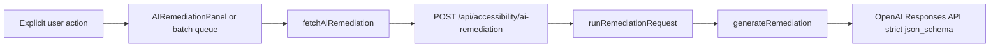

# AI Remediation Assistant — Final Production Launch Audit (AI-R5)

Audit date: **2026-10-16**  
Prerequisites: **AI-R1–R4 GATE: PASS** ([`AI_R1_GATE_AUDIT.md`](AI_R1_GATE_AUDIT.md) … [`AI_R4_GATE_AUDIT.md`](AI_R4_GATE_AUDIT.md))

## Executive summary

| Item | Result |
|------|--------|
| **Final status** | **AI REMEDIATION: READY WITH CONDITIONS** |
| **Production enablement** | **ENABLED AFTER LIVE SMOKE TEST** (operator-configured key + `OPENAI_REMEDIATION_MODEL`) |
| **Website Scanner public** | **BLOCKED BY LAYER-2** (separate from core AI remediation readiness) |
| **Critical blockers (§159)** | **None** |

### Launch conditions (non-blocking)

1. Per-instance in-memory **cache** and **rate limits** (not global distributed quota).
2. No **cross-instance in-flight deduplication** (`inFlight` ref in UI only).
3. Anonymous **session IDs** are cost-control identifiers, not authenticated identity.
4. **LIVE PROVIDER TEST: NOT VERIFIED** in CI (mocked tests only).
5. **PDF visual clipping** — manual production QA recommended (`@react-pdf/renderer` limits).
6. **Mobile / AI UI** spot-check at 320–1024px recommended (automated component E2E not in scope).
7. Batch **5/run** and **20/session** are client queue limits; shared API session/scan caps still apply.
8. Operator must confirm chosen **`OPENAI_REMEDIATION_MODEL`** supports strict Structured Outputs before public enablement.
9. **Website Accessibility Scanner** public launch remains gated on **Layer-2 network egress** deployment.

### Core tool readiness (R5)

| Tool | Status |
|------|--------|
| Social remediation | **READY** (with conditions above) |
| Image / alt remediation | **READY** |
| Contrast remediation | **READY** |
| Video cue remediation | **READY** |
| Batch remediation | **READY** |
| Reports & exports | **READY** |
| Website Fix Lab remediation | **READY** (scanner **public** launch still Layer-2 gated) |

---

## Verification runs

| Command | Result |
|---------|--------|
| `npm run test:ai-remediation` | PASS (**84** tests) |
| `npm run test:security` | PASS (**79** passed, **7** skipped) |
| `npm run test:sample-report` | PASS (5 tests) |
| `npx vitest run src/features/reports/__tests__` | PASS (7 tests) |
| `npx vitest run src/features/website-scanner/__tests__/developerTicket.test.ts` | PASS (13 tests) |
| `npx vitest run src/features/batch` | PASS (11 tests) |
| `npm run test:accessibility` | PASS (26 passed, 2 skipped) |
| `npm run lint` | PASS |
| `npm run typecheck` | PASS |
| `npm run build` | PASS |
| `npm run test:seo` | PASS (5 tests) |
| `npm run audit:seo` | PASS (WARN: `NEXT_PUBLIC_SITE_URL` unset locally) |
| `npm run test:blog` | PASS (11 tests) |

---

## Architecture

Single remediation pipeline for all product surfaces:

| Check | Evidence | Status |
|-------|----------|--------|
| Shared types & validation | [`src/lib/ai/remediation/`](src/lib/ai/remediation/) | PASS |
| R4 report appendix (default OFF) | [`AI_REMEDIATION_REPORT_EXPORTS.md`](AI_REMEDIATION_REPORT_EXPORTS.md), [`AI_R4_GATE_AUDIT.md`](AI_R4_GATE_AUDIT.md) | PASS |
| Dead legacy engine file | [`generateWebsiteFixGuidance.ts`](src/features/website-scanner/server/ai/generateWebsiteFixGuidance.ts) unused | LOW cleanup only |

---

## OpenAI request inventory

| Feature | Route | Model env | Trigger | Normal requests | Max attempts (app) | Disclosure | Storage |
|---------|-------|-----------|---------|-----------------|-------------------|------------|---------|
| **AI remediation (all sources)** | `POST /api/accessibility/ai-remediation` | **`OPENAI_REMEDIATION_MODEL` required** | Explicit generate buttons / batch queue | **1** per action on cache miss | **1** app call; SDK may retry transient errors | AI-Assisted labels; human review copy | Session/tab cache only; not MongoDB |
| Website Fix Lab | Same | Same | **Generate AI-Assisted Remediation** per root cause | **1** per grouped root cause | Same | Fix Lab + panel | `aiRemediationByGroup` |
| Social | Same | Same | **Generate Accessible Revision** | 1 | Same | Panel | Checker session |
| Image alt | Same | Same | **Generate Improved Alt Options** | 1; **no second vision call** | Same | Suggested alt; analyze-first hint | Session analysis JSON reused |
| Contrast | Same | Same | **Explain & Refine Fix** (optional) | 1 | Same | Measured ratio authoritative | Session |
| Video cue | Same | Same | **AI caption help** per cue | 1 per cue | Same | Cue-scoped | `sessionStorage` / video session |
| Batch | Same | Same | **AI remediation (selected)** | ≤**5/run**, ≤**20/session** UI | Same + API caps | Queue UI | Import row state |
| Image analysis | `POST /api/accessibility/analyze-image` | `OPENAI_VISION_MODEL` | **Analyze Image with AI** | 1 | Timeout only | Separate from remediation | Client session |
| Video transcription | `POST /api/accessibility/transcribe-video` | `OPENAI_CAPTION_MODEL` | Explicit transcript | 1 | Controlled errors | Privacy page | Temp blob |
| Video visual | `POST /api/accessibility/analyze-video-frames` | Vision model | Explicit visual review | 1 | Same | Privacy page | Bounded frames |
| Visual Issue Locator | token + visualize APIs | — | **View on Page** | **0 OpenAI** | N/A | No AI | Tab session blob |
| Reports / PDF / Excel / CSV / JSON / ZIP / ticket / sample | — | — | Export / copy | **0** | N/A | Sample fictional labels | Client export only |
| ~~Website ai-fix-guidance~~ | `POST …/ai-fix-guidance` | — | — | **0** (410) | — | Deprecated message | — |

Source of truth: [`OPENAI_COST_MAP.md`](OPENAI_COST_MAP.md), [`DATA_PROCESSING_MATRIX.md`](DATA_PROCESSING_MATRIX.md).

---

## Model configuration

| Check | Evidence | Test | Status |
|-------|----------|------|--------|
| Remediation model required | [`getRemediationModel()`](src/lib/openai/config.ts) throws if unset | `remediation.test.ts` | PASS |
| No silent fallback to `OPENAI_TEXT_MODEL` for remediation | Remediation path uses `OPENAI_REMEDIATION_MODEL` only | Code review | PASS |
| Missing key / flag / model → 503 | [`ai-remediation/route.ts`](src/app/api/accessibility/ai-remediation/route.ts) | `aiR5FinalLaunchAudit.test.ts` | PASS |
| Kill switch `AI_REMEDIATION_ENABLED=0` | [`isAiRemediationEnabled()`](src/lib/openai/config.ts) | `aiR5FinalLaunchAudit.test.ts` | PASS |
| Build without OpenAI credentials | `npm run build` PASS | Matrix | PASS |

---

## Single remediation engine & legacy route

| Check | Evidence | Status |
|-------|----------|--------|
| One OpenAI remediation entry | `generateRemediation` → `client.responses.create` + strict schema | PASS |
| Legacy website route | **410** `AI_FIX_GUIDANCE_DEPRECATED`, zero OpenAI | PASS |
| No live client to legacy route | Grep `ai-fix-guidance` — tests only | PASS |
| Client cannot set model/prompt | [`validateRemediationRequest`](src/lib/ai/remediation/validateRemediationRequest.ts) allowlist | PASS |

---

## Responses API & structured outputs

| Check | Evidence | Status |
|-------|----------|--------|
| Official OpenAI SDK | [`getOpenAiClient`](src/lib/openai/client.ts) | PASS |
| `responses.create` | [`generateRemediation.ts`](src/lib/ai/remediation/generateRemediation.ts) | PASS |
| Strict JSON schema | `aiRemediationJsonSchema`, `strict: true` | PASS |
| Refusal / incomplete / timeout / 429 | `remediation.test.ts` | PASS |
| Deterministic tools usable on failure | UI error states; no auto-retry loops | PASS |

---

## Explicit action audit

| Surface | `fetchAiRemediation` on mount/load/export? | Evidence | Status |
|---------|-------------------------------------------|----------|--------|
| Shared panel | No — generate handler only | `aiR3ExplicitActionGate.test.ts` | PASS |
| Website / social / image / contrast / video | Via panel only | Grep: **2** product call sites | PASS |
| Batch | `runBatchRemediationQueue.processOne` only | Explicit action gate | PASS |
| Report / PDF / Excel / CSV / JSON / ZIP | **0 calls** | `aiR4GateAudit.test.ts`, `aiR5FinalLaunchAudit.test.ts` | PASS |
| Developer ticket | Cached text only; default OFF | `developerTicket.test.ts` | PASS |
| Sample report | Static fixture | `sampleFixture.test.ts` | PASS |

Allowed triggers (user action only): **Generate AI-Assisted Remediation**, **Generate Accessible Revision**, **Generate Improved Alt Options**, **Explain & Refine Fix**, **AI caption help**, **AI remediation (selected)**.

---

## Cost controls

| Control | Implementation | Status |
|---------|----------------|--------|
| Rate limit | [`checkAiRemediationRateLimit`](src/lib/rateLimit/checkAiRemediationRateLimit.ts) per client key | PASS (CONDITION: per instance) |
| Session cap | `MAX_AI_REMEDIATIONS_PER_SESSION` (default 12) | PASS |
| Scan cap | `MAX_AI_REMEDIATIONS_PER_SCAN` (default 8) | PASS |
| Batch UI caps | 5/run, 20/session [`planBatchRemediationRun`](src/features/batch/utils/ai/planBatchRemediationRun.ts) | PASS |
| Payload limit | `MAX_REMEDIATION_REQUEST_BYTES` | PASS |
| Timeout | `AbortSignal.timeout` in `generateRemediation` | PASS |
| Fingerprint cache | `runRemediationRequest` before provider call | PASS |
| App retry loops | None on export/render | PASS |
| Double-click | `inFlight` ref in [`AIRemediationPanel`](src/lib/ai/remediation/components/AIRemediationPanel.tsx) | PASS |
| SDK transient retry | Documented honest limitation | CONDITION |

---

## Cache / rate limit / serverless reality

| Topic | Status |
|-------|--------|
| Cache scope | **Per runtime instance**, time-bounded — not global |
| In-flight dedup | **Same tab/panel only** — not cross-instance |
| Rate limit scope | **Per instance** memory limiter |
| Anonymous session IDs | UUID-style; not email/URL/caption — **CONDITION** acceptable for controlled launch |
| Abuse exposure | Mitigated by caps + rate limit + payload limits — **CONDITION** monitor in production |

---

## Privacy & storage

| Domain | Bounded payload | Status |
|--------|-----------------|--------|
| Website | Representative evidence via `buildWebsiteRemediationContext` — no full HTML/DOM/cookies | PASS |
| Social | Caption + platform context | PASS |
| Image remediation | Structured prior analysis; no image blob in remediation facts | PASS |
| Contrast | Measured colors/ratios | PASS |
| Video | Selected cue + neighbors — no full video to text remediation | PASS |
| Batch | Selected rows only | PASS |
| MongoDB | No `aiRemediation` in blog DB paths | PASS |
| sessionStorage | Video/visual/panel disclosure — tab-scoped | PASS (documented) |
| Logging | [`recordRemediationUsage`](src/lib/ai/remediation/recordRemediationUsage.ts) metadata only | PASS |

Privacy page: [`src/app/privacy/page.tsx`](src/app/privacy/page.tsx) covers remediation, exports, and tickets.

---

## Prompt injection & secret leakage

| Check | Evidence | Status |
|-------|----------|--------|
| Injection strings in evidence delimiters | `remediation.test.ts` | PASS |
| Hostile output in UI/exports | `aiR3ReportSafetyGate.test.ts`, `aiR4GateAudit.test.ts` | PASS |
| No system prompt in API response | Validated report schema only | PASS |
| No raw provider stacks to browser | `AiRemediationError` user messages | PASS |
| JSON export secret audit | `aiR4GateAudit.test.ts` | PASS |
| Repo secrets grep | No committed `sk-` production keys (test fixtures only) | PASS |

---

## Domain summaries

### Website (R2)

Root-cause-level only; facts authoritative in UI/exports; stale guidance excluded by default ([`AI_R2_GATE_AUDIT.md`](AI_R2_GATE_AUDIT.md), context tests).

### Social / image / contrast / video / batch (R3)

Adapters preserve facts; contrast ratio conflict tests; no vision on remediation path; batch caps ([`AI_R3_GATE_AUDIT.md`](AI_R3_GATE_AUDIT.md)).

### Reports & exports (R4)

Default OFF; fact columns; formula/XSS/PDF/Excel; evidence ZIP zero-call ([`AI_R4_GATE_AUDIT.md`](AI_R4_GATE_AUDIT.md), `aiR5FinalLaunchAudit.test.ts`).

---

## Accessibility (AI UI)

| Check | Method | Status |
|-------|--------|--------|
| Panel labels, loading/error, apply/undo | Code review [`AIRemediationPanel`](src/lib/ai/remediation/components/AIRemediationPanel.tsx) | PASS |
| Report inclusion control | [`ReportAiRemediationInclusionPanel`](src/features/reports/components/ReportAiRemediationInclusionPanel.tsx) | PASS |
| Keyboard / SR / mobile breakpoints | Manual production QA recommended | CONDITION |
| Status not color-only | Existing design tokens + text | PASS (review) |

---

## Security

| Check | Status |
|-------|--------|
| SSRF unit tests | PASS (`test:security`) |
| Skipped integration tests | See table below — **not AI blockers** |
| Spreadsheet injection | PASS (`batchCsv.test.ts`, `aiR4GateAudit.test.ts`) |
| HTML XSS in appendix | PASS |

### Skipped security tests (§123–124)

| File | Skip condition | Classification |
|------|----------------|----------------|
| `ssrf.integration.test.ts` | `WEBSITE_SCANNER_INTEGRATION=1` + loopback | **EXPECTED / PLATFORM-CONDITIONAL** |
| `ssrf.worker-auth.test.ts` | env `RUN` | **EXPECTED / PLATFORM-CONDITIONAL** |
| `playwrightScan.integration.test.ts` | integration env | **EXPECTED / PLATFORM-CONDITIONAL** |
| `accessibilityBenchmark.integration.test.ts` | env `RUN` | **NOT APPLICABLE** to AI remediation |

None classify as **UNVERIFIED RISK** for core AI remediation launch; they gate **scanner infrastructure** verification.

---

## Performance

| Check | Status |
|-------|--------|
| OpenAI SDK server-only | PASS (`server-only` imports) |
| Export libs lazy-loaded (JSZip, exceljs, react-pdf in export paths) | PASS (dynamic import pattern) |
| No indexable user-specific AI URLs | PASS |

---

## Product claims & legal positioning

| Check | Result |
|-------|--------|
| Grep banned phrases (“AI fixes your website”, “guaranteed fix”, “WCAG compliant after AI”, etc.) | **None** in `src/` |
| Positioning | **AI-Assisted Remediation**, suggested implementation, human review, rescan |
| AI does not set Resolved/Passed/Compliant | Code + copy review | PASS |

---

## Operational kill switch & incident response

| Action | Mechanism |
|--------|-----------|
| Disable AI remediation | Set `AI_REMEDIATION_ENABLED=0` or unset key/model → **503** `AI_REMEDIATION_UNAVAILABLE` |
| Deterministic tools | Continue without remediation API |
| Cost / provider outage | Same kill switch; no site-wide shutdown required |

Documented in [`AI_REMEDIATION_ARCHITECTURE.md`](AI_REMEDIATION_ARCHITECTURE.md).

---

## Testing added (R5)

| File | Purpose |
|------|---------|
| [`aiR5FinalLaunchAudit.test.ts`](src/lib/ai/remediation/__tests__/aiR5FinalLaunchAudit.test.ts) | Route 503/kill switch; evidence ZIP zero-call; client `model` rejection |

Prior gates: R1 `remediation.test.ts`, R3 explicit/image/batch gates, R4 export/gate audit.

---

## Live OpenAI & model quality

| Item | Status |
|------|--------|
| Paid live API in CI | **NOT RUN — COST-SAVING POLICY** |
| **LIVE PROVIDER TEST** | **NOT VERIFIED** |
| Mocked tests vs model quality | Mocked tests prove **application behavior**, not live model quality |
| Live eval before enablement | **Recommended** one controlled smoke test after env config |

---

## Website Scanner Layer-2 (separate launch gate)

| Item | Status |
|------|--------|
| Layer-2 egress deployed | **NOT DEPLOYED** (operator confirmed in prior audits) |
| **WEBSITE SCANNER PUBLIC ENABLEMENT** | **BLOCKED BY LAYER-2** |
| Core non-scanner AI tools | Unaffected by Layer-2 for their own readiness |

See [`WEBSITE_SCANNER_SECURITY.md`](WEBSITE_SCANNER_SECURITY.md), [`FINAL_PRODUCT_AUDIT.md`](FINAL_PRODUCT_AUDIT.md).

---

## Production environment requirements

From [`.env.example`](.env.example):

- `OPENAI_API_KEY` (server-only)
- `OPENAI_REMEDIATION_MODEL` (structured-output-capable)
- `AI_REMEDIATION_ENABLED=1` to enable (default example on)
- Optional: `MAX_AI_REMEDIATIONS_PER_SESSION`, `MAX_AI_REMEDIATIONS_PER_SCAN`, `OPENAI_REMEDIATION_TIMEOUT_MS`

**Note:** `OPENAI_TEXT_MODEL` is **not** used for shared AI remediation.

---

## §164 executive checklist (condensed)

| # | Topic | Status |
|---|-------|--------|
| 1–4 | Architecture / inventory / single engine / legacy 410 | PASS |
| 5–8 | Responses API / model required / missing model & key graceful | PASS |
| 9–10 | No auto remediation / user action only | PASS |
| 11–19 | Per-domain request counts / export zero-call | PASS |
| 20–28 | Cost controls / serverless conditions | PASS + CONDITION |
| 29–36 | Session IDs / MongoDB / storage scope | PASS |
| 37–43 | Domain payload privacy | PASS |
| 44–49 | Logging / injection / leakage | PASS |
| 50–51 | Structured output failures / fallback | PASS |
| 52–59 | Deterministic fact authority / red team exports | PASS |
| 60–64 | Code & framework quality (mocked/review) | PASS (live quality CONDITION) |
| 65–81 | Social/image/contrast/video/batch behaviors | PASS (R3 tests) |
| 82–97 | Reports/exports/ticket/sample | PASS |
| 98–106 | A11y/mobile | PASS + manual CONDITION |
| 107–111 | Performance / SEO | PASS |
| 112–120 | Claims / privacy docs / project status | PASS |
| 121–124 | Launch checklist / skipped security | PASS (classified) |
| 125–127 | Layer-2 vs core AI | CONDITION (scanner blocked) |
| 128–131 | Live test / model compatibility / env | CONDITION |
| 132–141 | Secrets / build / kill switch / abuse | PASS |
| 142–145 | Evals / mocked vs live quality | PASS + LIMITATION |
| 146–150 | No new analytics DB / no auto-fix / workflow | PASS |
| 151–152 | Workflow truth / test matrix | PASS |
| 153–155 | SEO/blog regression / no paid CI | PASS |
| 156–164 | This document / classifications / recommendations | PASS |

---

## Classified findings

| Severity | Finding |
|----------|---------|
| **PASS** | Single remediation engine, explicit action, structured outputs, fact authority, export safety, kill switch, MongoDB boundary |
| **CONDITION** | Per-instance cache/rate limits; live provider smoke; PDF/mobile manual QA; batch caps not global auth quota |
| **LOW** | Unused `generateWebsiteFixGuidance.ts` file |
| **BLOCKER** | **None** |

---

## Production-enablement recommendation

| Recommendation | Detail |
|----------------|--------|
| **AI remediation feature flag** | Enable after **one controlled live smoke test** with production `OPENAI_REMEDIATION_MODEL` |
| **Website scanner marketing/CTA** | Keep gated until **Layer-2** evidence attached |
| **Post-R5** | No AI-R6 — proceed to env config → live smoke → Layer-2 → deploy → SEO verification |

---

## Final confirmation

The AI Remediation Assistant has completed its final production audit. It preserves deterministic accessibility evidence, requires explicit AI actions, uses bounded structured OpenAI requests, keeps AI guidance separate from verification and compliance status, supports human review and rescan validation, and introduces no automatic website/source-code modification.

---

**AI REMEDIATION: READY WITH CONDITIONS**

**Conditions:** Per-instance cache and rate limits; no distributed in-flight dedup; anonymous session IDs; LIVE PROVIDER TEST NOT VERIFIED; manual PDF visual and mobile AI UI QA; operator verifies structured-output model; Website Scanner public launch BLOCKED BY LAYER-2 until egress controls are deployed and verified.
