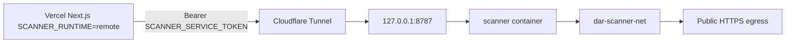

# Hostinger scanner worker deployment

Production remote Playwright worker for Digital Access Ready. The **authoritative** HTTP service is [`services/scanner/server.ts`](services/scanner/server.ts); Hostinger uses [`scanner-worker/docker-compose.yml`](scanner-worker/docker-compose.yml) to build and run it on **`dar-scanner-net`** with **loopback-only** host publish.

**Do not** modify Lapify, PM2, MySQL, host `iptables`/UFW, or create `dar-scanner-net` from this repo — those are operator-managed.

**REMOTE SCANNER ARCHITECTURE: PASS** — With `SCANNER_RUNTIME=remote` on Vercel, browser-dependent website scanner work (page scan, visual locator render, same-origin crawl discovery) runs only on the remote worker. Vercel does not import or launch Playwright for those paths.

## Phase 1 — Architecture audit (embedded)

| Area | Finding |
|------|---------|
| **Runtime selection** | [`getWebsiteScannerRuntime.ts`](src/features/website-scanner/server/runtime/getWebsiteScannerRuntime.ts): `remote` → [`RemoteScannerClient`](src/features/website-scanner/server/runtime/remoteScannerClient.ts); `local` → dynamic [`LocalPlaywrightScanner`](src/features/website-scanner/server/runtime/localPlaywrightScanner.ts). Vercel blocks local when `VERCEL=1` ([`scannerPlatform.ts`](src/features/website-scanner/server/config/scannerPlatform.ts)). |
| **Worker HTTP API (fixed paths)** | `GET /health`, `GET /ready`, `POST /v1/scan-page`, `POST /v1/discover-crawl`, `POST /v1/visualize-accessibility-issue` — **not** `POST /scan`. Vercel client expects these paths. |
| **Scan semantics** | Worker uses `LocalPlaywrightScanner` → [`pageScan.ts`](src/features/website-scanner/server/playwright/pageScan.ts), [`openValidatedScanPage.ts`](src/features/website-scanner/server/playwright/openValidatedScanPage.ts), network/redirect guards. |
| **Layer 1 SSRF** | [`validateScanTargetUrl`](src/features/website-scanner/server/security/validateScanTarget.ts), DNS tests in [`ssrf.test.ts`](src/features/website-scanner/__tests__/ssrf.test.ts) / [`ssrf.dns.test.ts`](src/features/website-scanner/__tests__/ssrf.dns.test.ts). |
| **Concurrency** | [`scanSemaphore.ts`](src/features/website-scanner/server/playwright/scanSemaphore.ts) via **`SCANNER_MAX_CONCURRENT`** (default 1, max 2). |
| **Visual Issue Locator** | HMAC mint on Vercel; remote render via `/v1/visualize-accessibility-issue`. |
| **Layer 2 on Hostinger** | External Docker network **`dar-scanner-net`** + host firewall (operator-verified). See [`SCANNER_SECURITY_GATE.md`](SCANNER_SECURITY_GATE.md). |
| **Crawl discovery** | [`discover-crawl`](src/app/api/accessibility/website/discover-crawl/route.ts) → `getWebsiteScannerRuntime().discoverCrawlUrls()` → worker `POST /v1/discover-crawl` → shared [`discoverCrawlUrls.ts`](src/features/website-scanner/server/discover/discoverCrawlUrls.ts). **No Playwright on Vercel in remote mode.** Sitemap XML discovery remains HTTP-only on Vercel (no browser). |



## Prerequisites (operator)

- Docker Compose v2 on Hostinger VPS
- External network **`dar-scanner-net`** already exists and is attached only to the scanner stack
- Host firewall denies scanner egress to RFC1918, loopback, link-local, metadata (see egress script)
- **No changes** to existing PM2/Lapify/MySQL stacks

## Deploy path

Recommended directory on VPS:

```text
/opt/digitalaccessready/scanner-worker
```

1. Clone or rsync this repository (full monorepo root is the Docker build context).
2. Copy env template:

   ```bash
   cd /opt/digitalaccessready/scanner-worker
   cp .env.example .env
   openssl rand -hex 32   # paste into SCANNER_SERVICE_TOKEN=
   ```

3. Build and start **only** this compose project:

   ```bash
   docker compose up --build -d
   ```

4. Health:

   ```bash
   curl -s http://127.0.0.1:8787/health
   # {"ok":true,"runtime":"playwright"}
   ```

5. Authenticated smoke (replace token):

   ```bash
   curl -s -X POST http://127.0.0.1:8787/v1/scan-page \
     -H "Authorization: Bearer $SCANNER_SERVICE_TOKEN" \
     -H "Content-Type: application/json" \
     -d '{"url":"https://example.com/","viewport":{"id":"desktop","width":1440,"height":900,"label":"Desktop"}}'

   curl -s -X POST http://127.0.0.1:8787/v1/discover-crawl \
     -H "Authorization: Bearer $SCANNER_SERVICE_TOKEN" \
     -H "Content-Type: application/json" \
     -d '{"siteUrl":"https://example.com/"}'
   ```

6. Egress verification (inside container):

   ```bash
   docker compose exec scanner sh /app/scanner-worker/scripts/verify-egress.sh
   # Optional host public IP test:
   docker compose exec scanner sh /app/scanner-worker/scripts/verify-egress.sh YOUR.VPS.PUBLIC.IP
   ```

## Cloudflare Tunnel (manual)

Expose the worker to Vercel without opening a public port on the host:

1. Create tunnel hostname **`scanner.digitalaccessready.com`** (or your chosen subdomain).
2. Route to **`http://127.0.0.1:8787`** on the VPS.
3. On Vercel (server env only):

   ```env
   SCANNER_RUNTIME=remote
   SCANNER_SERVICE_URL=https://scanner.digitalaccessready.com
   SCANNER_SERVICE_TOKEN=<same secret as worker .env>
   WEBSITE_SCANNER_PUBLIC_ENABLED=0
   ```

Worker auth is **Bearer only** — Cloudflare does not replace token checks.

## Chromium sandbox

Image: `mcr.microsoft.com/playwright:v1.64.1-noble`, process user **`pwuser`**, no `--no-sandbox`, no privileged mode. Sandbox enabled via official Playwright image defaults.

## Logs and rollback

```bash
docker compose logs -f scanner
docker compose stop
docker compose down   # removes only this compose project, not dar-scanner-net
```

Operational logs include request id, duration, violation count — **no** URLs with query strings, tokens, or HTML bodies.

## Developer verification (repo root)

```bash
npm run lint
npm run typecheck
npx vitest run services/scanner/__tests__
npm run test:security
npm run build
```

## Related docs

- [`SCANNER_SECURITY_GATE.md`](SCANNER_SECURITY_GATE.md) — public enablement gates (currently **BLOCKED**)
- [`WEBSITE_SCANNER_SECURITY.md`](WEBSITE_SCANNER_SECURITY.md) — Layer 1 + Layer 2 overview
- [`services/scanner/deploy/README.md`](services/scanner/deploy/README.md) — Kubernetes NetworkPolicy example (non-Hostinger)
